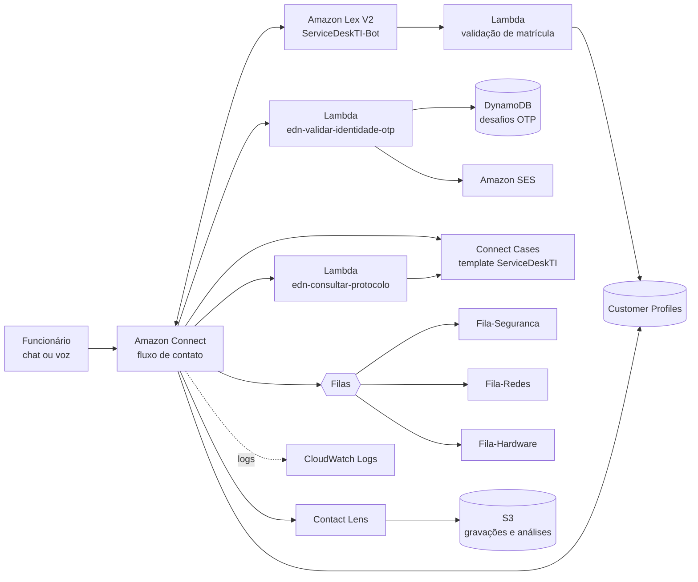
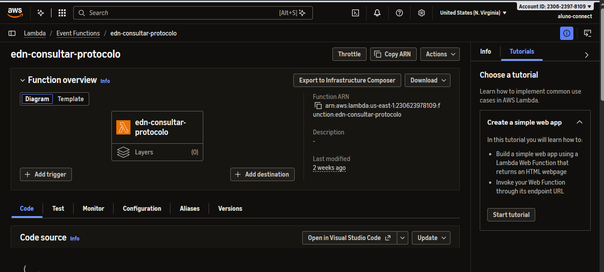
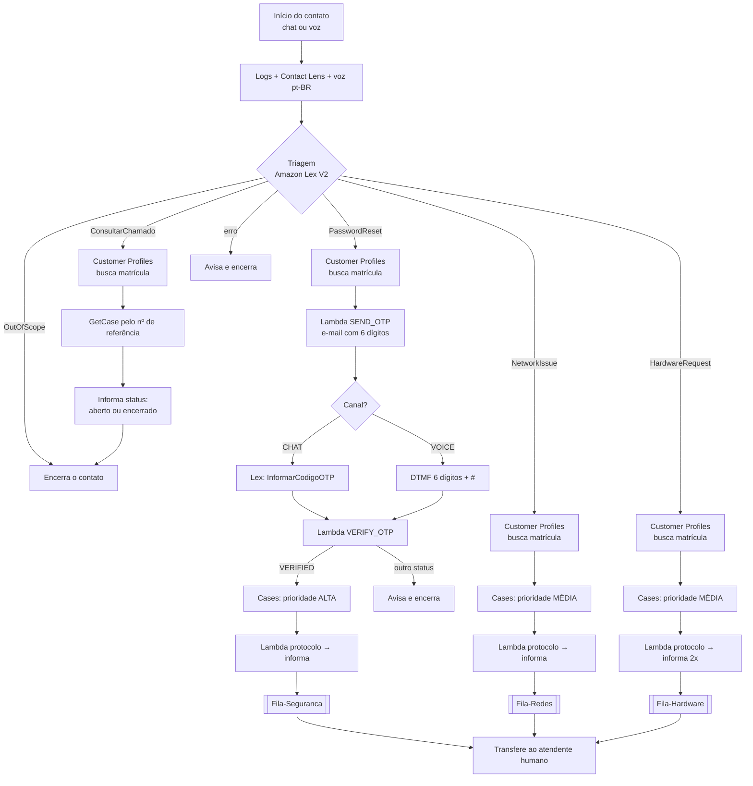

# Service Desk de TI Omnichannel — Amazon Connect

> **Curso Amazon Connect | Escola da Nuvem | Turma Piloto — Case 2: Service Desk Interno (Suporte de TI)**
> Chat online + Voz · IA conversacional (Amazon Lex V2) · Região `us-east-1` · Idioma/voz `pt-BR` (Ana Paula)

---

## Sumário

1. [Tecnologias utilizadas](#1-tecnologias-utilizadas)
2. [Visão geral do projeto](#2-visão-geral-do-projeto)
3. [Requisitos do case e cobertura](#3-requisitos-do-case-e-cobertura)
4. [Arquitetura](#4-arquitetura)
5. [Configuração passo a passo](#5-configuração-passo-a-passo)
   - 5.1 [Instância e canais](#51-instância-do-amazon-connect-e-canais)
   - 5.2 [Customer Profiles](#52-customer-profiles-base-de-funcionários)
   - 5.3 [Filas e roteamento](#53-filas-e-roteamento)
   - 5.4 [Connect Cases](#54-connect-cases-chamados)
   - 5.5 [Amazon Lex V2](#55-amazon-lex-v2-triagem-por-intenção)
   - 5.6 [Funções Lambda](#56-funções-lambda)
   - 5.7 [OTP: DynamoDB e SES](#57-otp-dynamodb-e-ses)
   - 5.8 [Contact Lens](#58-contact-lens-transcrição-e-sentimento)
   - 5.9 [Fluxo de contato](#59-fluxo-de-contato-fluxoservicedesk-ti-teste-protocolo)
6. [Fluxo de atendimento detalhado](#6-fluxo-de-atendimento-detalhado)
7. [Tratamento de falhas](#7-tratamento-de-falhas)
8. [Segurança](#8-segurança)
9. [Métricas para o supervisor (FCR e TMA)](#9-métricas-para-o-supervisor-fcr-e-tma)
10. [Testes realizados](#10-testes-realizados)
11. [Custo estimado mensal](#11-custo-estimado-mensal)
12. [Lista de imagens](#12-lista-de-imagens)
13. [Estrutura do repositório](#13-estrutura-do-repositório)

---

## 1. Tecnologias utilizadas

| Tecnologia | Papel no projeto |
|---|---|
| **Amazon Connect** | Central de atendimento (chat + voz): fluxo de contato `Fluxo-ServiceDesk-TI-TESTE-Protocolo`, filas, perfis de roteamento e métricas |
| **Amazon Connect Cases** | Abertura e consulta de chamados (template `ServiceDeskTI`) com categoria, prioridade e fila atribuída |
| **Amazon Connect Customer Profiles** | Base de funcionários; validação da identidade pela matrícula (`_account`) |
| **Amazon Lex V2** | Bot `ServiceDeskTI-Bot`: triagem por intenção, captura de matrícula, protocolo e código OTP no chat |
| **AWS Lambda** | `edn-consultar-protocolo` (devolve o nº do protocolo), `edn-validar-identidade-otp` (envia/valida OTP), validação de matrícula do Lex e geração de token JWT do widget de chat |
| **Amazon DynamoDB** | Armazena o desafio OTP (hash HMAC, tentativas, expiração) e o controle de intervalo entre envios |
| **Amazon SES** | Envio do código OTP por e-mail de recuperação |
| **Contact Lens for Amazon Connect** | Transcrição, análise de sentimento (chat e voz) e gravação de voz |
| **Amazon S3** | Armazenamento das gravações de voz e dos dados do Contact Lens |
| **Amazon CloudWatch Logs** | Logs do fluxo, do Lex e das Lambdas |
| **AWS IAM** | Perfis de execução das Lambdas e permissões entre serviços (Connect ↔ Lambda ↔ Lex) |
| **Amazon API Gateway (JWT authorizer)** | Protege a Lambda que emite o token do widget de chat |
| **AWS CloudFormation** | Função auxiliar (custom resource) que define o *alias* da conta IAM |

---

## 2. Visão geral do projeto

Uma empresa de médio porte tinha um help desk de TI sem triagem automática: colaboradores abriam chamados por e-mail ou ligavam para um ramal, o que gerava fila, falta de priorização e baixa visibilidade de indicadores.

A solução é um **service desk omnichannel** (chat online + voz) em que um assistente virtual:

1. identifica o motivo do contato (intenção);
2. valida o funcionário pela matrícula;
3. exige **verificação por OTP** quando a intenção é recuperação de senha;
4. **abre o chamado automaticamente** no Connect Cases com categoria e prioridade;
5. informa o **protocolo** ao usuário;
6. **encaminha para a fila** da equipe correta (Segurança, Redes ou Hardware).

**Objetivo de negócio:** reduzir o TMA (tempo médio de atendimento) e aumentar o FCR (resolução no primeiro contato).

---

## 3. Requisitos do case e cobertura

| Entregável do case | Como foi atendido |
|---|---|
| Fluxo no Connect com ≥ 3 intenções no Lex (`PasswordReset`, `NetworkIssue`, `HardwareRequest`) | Bot `ServiceDeskTI-Bot` com as 3 intenções + `ConsultarChamado`, `OutOfScope` e `InformarCodigoOTP` (captura do código) |
| Filas segmentadas com roteamento automático por intenção | `Fila-Seguranca`, `Fila-Redes`, `Fila-Hardware`; o fluxo define a fila de destino conforme a intenção detectada |
| Integração com Connect Cases (categoria e prioridade) | Template `ServiceDeskTI`: `case_reason` = intenção, prioridade Alta (senha) ou Média (rede/hardware), `assigned_queue`, `customer_id`, `status` aberto |
| Contact Lens (transcrição e sentimento) | Habilitado no fluxo para chat e voz, em `pt-BR`, com gravação de voz |
| Métricas de FCR e TMA para o supervisor | Dashboards/métricas históricas do Connect (ver [seção 9](#9-métricas-para-o-supervisor-fcr-e-tma)) |
| Cenário "solicitação de equipamento" com notificação e acompanhamento | Caso criado automaticamente, protocolo informado duas vezes e consulta de status pela intenção `ConsultarChamado` |

---

## 4. Arquitetura


> 📸 **Imagem 01 — Arquitetura geral:** diagrama (draw.io, Lucidchart ou print do PDF) mostrando Connect, Lex, Lambdas, Customer Profiles, Cases, DynamoDB, SES, S3 e CloudWatch.



---

## 5. Configuração passo a passo

### 5.1 Instância do Amazon Connect e canais

- Região: **us-east-1 (N. Virginia)**.
- Canais habilitados: **Voz** e **Chat**.
- Opções da instância: Contact Lens (análises conversacionais), Customer Profiles, Cases e integração com Lex/Lambda.
- Armazenamento (S3) para gravações de chamadas e dados do Contact Lens.


> 📸 **Imagem 02 — Instância Connect:** tela de *Data storage / Telephony / Flows* da instância (Console AWS → Amazon Connect → instância).

### 5.2 Customer Profiles (base de funcionários)

- Domínio do Customer Profiles associado à instância.
- Cada funcionário é um perfil com **`AccountNumber` = matrícula de 4 dígitos**, nome e e-mail (pessoal/de recuperação).
- O fluxo e a Lambda localizam o perfil pela chave `_account`.

| Campo | Uso |
|---|---|
| `AccountNumber` | Matrícula (chave de busca `_account`) |
| `FirstName`, `MiddleName`, `LastName` | Saudação/identificação |
| `PersonalEmailAddress` / `EmailAddress` | Destino do OTP (prioriza o e-mail pessoal) |
| `ProfileId` | Enviado à Lambda de OTP para vincular o desafio ao perfil |

### 5.3 Filas e roteamento

| Fila | Equipe | Intenção que alimenta |
|---|---|---|
| `Fila-Seguranca` | Segurança da informação | `PasswordReset` (prioridade **Alta**) |
| `Fila-Redes` | Infraestrutura e redes | `NetworkIssue` (prioridade **Média**) |
| `Fila-Hardware` | Hardware / equipamentos | `HardwareRequest` (prioridade **Média**) |

- Cada fila possui horário de funcionamento, número de contato de saída e **perfil de roteamento** com os canais Chat e Voz.
- No fluxo, o bloco **Definir fila de trabalho** (`UpdateContactTargetQueue`) escolhe a fila e o bloco **Transferir para fila** (`TransferContactToQueue`) envia o contato ao atendente.


> 📸 **Imagem 03 — Filas:** Routing → Queues, mostrando `Fila-Seguranca`, `Fila-Redes` e `Fila-Hardware`.

### 5.4 Connect Cases (chamados)

Template **`ServiceDeskTI`** com os campos usados pelo fluxo:

| Campo | Valor gravado pelo fluxo |
|---|---|
| `case_reason` (categoria) | `PasswordReset`, `NetworkIssue` ou `HardwareRequest` |
| Prioridade (campo customizado) | `High` (senha) · `Medium` (rede e hardware) |
| `assigned_queue` | ARN da fila de destino |
| `customer_id` | ARN do perfil do funcionário (`$.Customer.ProfileARN`) |
| `status` | Aberto (`open`) |
| `reference_number` | Gerado pelo Cases; é o **protocolo** informado ao usuário |

O bloco **Criar caso** usa `LinkContactToCase = true`, vinculando o contato ao chamado.


> 📸 **Imagem 04 — Cases:** Cases → Templates → `ServiceDeskTI` com os campos listados acima.

### 5.5 Amazon Lex V2 (triagem por intenção)

**Bot:** `ServiceDeskTI-Bot` · idioma `pt-BR` · voz Ana Paula (Polly).

| Intenção | Finalidade | Slots principais |
|---|---|---|
| `PasswordReset` | Recuperação de senha (exige OTP) | `MatriculaFuncionario` |
| `NetworkIssue` | Problema de rede / internet | `MatriculaFuncionario` |
| `HardwareRequest` | Solicitação de equipamento | `MatriculaFuncionario` |
| `ConsultarChamado` | Consulta de status de chamado | `MatriculaConsulta`, `NumeroProtocolo` |
| `InformarCodigoOTP` | Captura do código OTP no **chat** | `CodigoOTP` |
| `OutOfScope` (fallback) | Assuntos fora do escopo → encerra o contato | — |

- O **code hook de diálogo** do slot de matrícula chama a Lambda de validação (ver 5.6), que exige 4 dígitos e confirma a existência no Customer Profiles.
- O bot possui **alias** associado à instância do Connect (permissão de invocação concedida em *Flows → Amazon Lex*).


> 📸 **Imagem 05 — Lex, lista de intenções:** Console Lex V2 → `ServiceDeskTI-Bot` → idioma pt-BR → Intents.


> 📸 **Imagem 06 — Lex, detalhe de intenção:** `PasswordReset` com *sample utterances*, slot `MatriculaFuncionario` e o *code hook* habilitado.


> 📸 **Imagem 07 — Lex, alias e integração:** alias do bot e tela *Amazon Connect → Flows → Amazon Lex* com o bot adicionado.

### 5.6 Funções Lambda

| Função | Quem chama | O que faz |
|---|---|---|
| `edn-consultar-protocolo` | Fluxo do Connect | Lê o `reference_number` do caso criado e devolve o protocolo |
| `edn-validar-identidade-otp` | Fluxo do Connect | Ações `SEND_OTP` e `VERIFY_OTP` |
| Validação de matrícula | Lex (*code hook*) | Valida formato e existência da matrícula no Customer Profiles |
| Validação JWT (widget) | API Gateway | Emite token HS256 de 5 min para o widget de chat (exige claim `sub` do autorizador) |
| Função auxiliar (CloudFormation) | Custom resource | Cria/atualiza o *alias* da conta IAM |



> 📸 **Imagem 08 — Lambda `edn-consultar-protocolo`:** visão geral da função no console (arquivo já existente: `imagem/Lambda_Consultar_Protocolo.png`).


> 📸 **Imagem 09 — Lambda, configuração:** aba *Configuration* → *Environment variables* e *Permissions* (oculte valores secretos antes do print).

#### 5.6.1 `edn-consultar-protocolo`

- **Entrada:** `Details.Parameters.caseId` (UUID do caso, vindo de `$.Case.case_id`).
- **Variável de ambiente:** `CASES_DOMAIN_ID`.
- **Lógica:** valida o formato do UUID, chama `connectcases.get_case` pedindo `reference_number` e faz **até 3 tentativas** quando o caso ainda não está disponível (consistência eventual), com espera crescente (0,6 s e 1,2 s).
- **Saída (STRING_MAP):** `status` (`SUCCESS`, `NOT_FOUND`, `ERROR`, `CONFIG_ERROR`) e `referenceNumber`.

```python
def lambda_handler(event, context):
    params = event.get("Details", {}).get("Parameters", {})
    case_id = params.get("caseId") or event.get("caseId")
    domain_id = os.environ.get("CASES_DOMAIN_ID", "")

    if not case_id or not re.fullmatch(r"[0-9a-fA-F-]{36}", str(case_id)):
        return {"status": "ERROR", "referenceNumber": ""}
    if not domain_id:
        return {"status": "CONFIG_ERROR", "referenceNumber": ""}

    for attempt in range(3):
        try:
            response = cases.get_case(
                domainId=domain_id, caseId=case_id,
                fields=[{"id": "reference_number"}]
            )
            for field in response.get("fields", []):
                if field.get("id") == "reference_number":
                    number = field.get("value", {}).get("stringValue", "")
                    if number:
                        return {"status": "SUCCESS", "referenceNumber": str(number)}
            return {"status": "NOT_FOUND", "referenceNumber": ""}
        except cases.exceptions.ResourceNotFoundException:
            if attempt < 2:
                time.sleep(0.6 * (attempt + 1))
                continue
            return {"status": "NOT_FOUND", "referenceNumber": ""}
        except ClientError as error:
            print("GetCase error:", error.response["Error"].get("Code", "Unknown"))
            return {"status": "ERROR", "referenceNumber": ""}
    return {"status": "NOT_FOUND", "referenceNumber": ""}
```

**Permissão IAM necessária:** `connectcases:GetCase`.

#### 5.6.2 `edn-validar-identidade-otp`

- **Variáveis de ambiente:** `OTP_TABLE`, `SES_FROM_EMAIL`, `CUSTOMER_PROFILES_DOMAIN`, `OTP_HMAC_KEY` (mínimo 32 caracteres).
- **Parâmetros recebidos do Connect:** `action` (`SEND_OTP` | `VERIFY_OTP`), `profileId`, `matricula` e, somente na verificação, `code`. O `ContactId` vem de `ContactData`.
- **Permissões IAM:** `profile:BatchGetProfile`, `ses:SendEmail`, `dynamodb:GetItem/PutItem/UpdateItem/DeleteItem`.
- **Constantes:** OTP válido por **300 s**, intervalo de **60 s** entre envios por funcionário, máximo de **3 tentativas**.

| Ação | Comportamento | Possíveis `status` |
|---|---|---|
| `SEND_OTP` | Lê o perfil oficial (não aceita e-mail informado pelo contato), aplica *cooldown* por perfil, gera OTP de 6 dígitos com `secrets`, grava **apenas o hash HMAC-SHA256** (vinculado a `ContactId + profileId`) no DynamoDB e envia o e-mail pelo SES | `SENT`, `WAIT`, `UNAVAILABLE` |
| `VERIFY_OTP` | Valida formato, existência, vínculo com perfil/matrícula, expiração e tentativas; compara com `hmac.compare_digest`; marca como usado com atualização condicional atômica | `VERIFIED`, `INVALID`, `EXPIRED`, `LOCKED`, `UNAVAILABLE` |

Trecho central da verificação (uso único e anti-reutilização):

```python
if hmac.compare_digest(challenge.get("digest", ""), _digest(contact_id, profile_id, otp)):
    table.update_item(
        Key={"challengeId": contact_id},
        UpdateExpression="SET used = :yes",
        ConditionExpression=(
            "profileId = :profile AND accountNumber = :account "
            "AND digest = :digest AND used = :no "
            "AND attempts < :max AND expiresAt > :now"
        ),
        ...
    )
    return _response("VERIFIED")
```

> O código-fonte completo está em `Códigos_Lambda/` (ver [seção 13](#13-estrutura-do-repositório)).

#### 5.6.3 Validação de matrícula (Lex *code hook*)

- **Variável de ambiente:** `CUSTOMER_PROFILES_DOMAIN`. **Permissão:** `profile:SearchProfiles`.
- Regras: matrícula deve casar `^[0-9]{4}$`; busca por `_account`; se não encontrar → pede novamente (`ElicitSlot`); se houver mais de um resultado → encerra com "Cadastro ambíguo".
- Em caso de sucesso, grava nos *session attributes*: `matriculaValidada`, `nomeFuncionario` e `perfilId`, e devolve `Delegate`.

#### 5.6.4 Validação JWT do widget de chat

- Só responde se a requisição vier de um **API Gateway com autorizador JWT** (claim `sub`); caso contrário retorna `401`.
- Gera um token **HS256** com validade de 5 minutos, assinado com o segredo do widget (`CONNECT_WIDGET_SECRET`, variável de ambiente) e devolve `{"data": "<token>"}` sem cache.

#### 5.6.5 Função auxiliar (CloudFormation)

*Custom resource* que cria o *alias* da conta IAM a partir de prefixo/nome da conta, tratando conflito de nomes anexando o ID da conta. Em `Delete` nunca falha, para não travar a remoção da stack.

### 5.7 OTP: DynamoDB e SES

**Tabela DynamoDB** (nome na variável `OTP_TABLE`):

| Atributo | Descrição |
|---|---|
| `challengeId` *(chave de partição)* | `ContactId` (desafio) ou `RATE#<profileId>` (limitador de envios) |
| `profileId`, `accountNumber` | Vínculo do desafio com o funcionário |
| `digest` | HMAC-SHA256 do código (o código em si **não** é armazenado) |
| `attempts`, `used` | Controle de tentativas e uso único |
| `expiresAt` | Epoch de expiração (ideal: habilitar **TTL** neste atributo) |

**Amazon SES:** identidade do remetente verificada (`SES_FROM_EMAIL`). Em conta *sandbox*, o destinatário também precisa estar verificado.


> 📸 **Imagem 10 — OTP:** tabela DynamoDB (itens/atributos) e identidade verificada no SES. Não exponha e-mails reais nem códigos.

### 5.8 Contact Lens (transcrição e sentimento)

Configurado no início do fluxo (blocos *Definir comportamento de gravação e análise*):

| Canal | Configuração |
|---|---|
| **Chat** | Análises do Contact Lens habilitadas · idioma `pt-BR` · **análise de sentimento** ligada · redação desativada |
| **Voz** | Gravação de **agente e cliente** + gravação da URA · análises `PostContact` e `AutomatedInteraction` · idioma `pt-BR` · **análise de sentimento** ligada |


> 📸 **Imagem 11 — Contact Lens:** blocos de gravação/análise do fluxo (chat e voz) e/ou a página de análise de uma conversa com transcrição e sentimento.

### 5.9 Fluxo de contato `Fluxo-ServiceDesk-TI-TESTE-Protocolo`

Fluxo do tipo *Contact flow* com 53 blocos. Estrutura de entrada:

1. **Habilitar logs do fluxo** (`FlowLoggingBehavior = Enabled`).
2. **Contact Lens – chat** → **Contact Lens – voz**.
3. **Definir voz** `Ana Paula` e **idioma** `pt-BR`.
4. **Triagem com Lex** (`ConnectParticipantWithLexBot`) com a mensagem de boas-vindas e ramificação por intenção.


> 📸 **Imagem 12 — Fluxo completo:** editor do Connect com o fluxo inteiro (use *zoom to fit*), de preferência com as 4 ramificações visíveis.


> 📸 **Imagem 13 — Ramo `PasswordReset`:** Customer Profiles → Lambda `SEND_OTP` → verificação de canal (Lex/DTMF) → Lambda `VERIFY_OTP` → Cases → protocolo → fila.


> 📸 **Imagem 14 — Bloco "Criar caso":** painel de propriedades mostrando template `ServiceDeskTI`, `case_reason`, prioridade e `assigned_queue`.

---

## 6. Fluxo de atendimento detalhado



### Resumo por intenção

| Intenção | Passos | Prioridade | Destino |
|---|---|---|---|
| **PasswordReset** | Busca matrícula → envia OTP → valida (Lex no chat / DTMF na voz) → cria caso → consulta protocolo → informa | **Alta** | `Fila-Seguranca` |
| **NetworkIssue** | Busca matrícula → cria caso → consulta protocolo → informa o número | Média | `Fila-Redes` |
| **HardwareRequest** | Busca matrícula → cria caso → consulta protocolo → informa o número **duas vezes** (para anotação) | Média | `Fila-Hardware` |
| **ConsultarChamado** | Busca funcionário (`MatriculaConsulta`) → `GetCase` pelo nº de referência (`NumeroProtocolo`) → informa protocolo, assunto e status | — | Encerra o contato |
| **OutOfScope** | Encerra o contato | — | — |

### Mensagens-chave do fluxo

- **Boas-vindas:** apresenta a assistente virtual e as opções (senha, rede, equipamento, consulta de chamado).
- **OTP enviado:** informa que um código de seis dígitos foi enviado ao e-mail de recuperação, válido por cinco minutos.
- **Voz (OTP):** "Digite os seis números do código recebido por e-mail e pressione `#` para confirmar" (timeout total 150 s; 12 s entre dígitos).
- **Protocolo:** "O número do seu protocolo é *X*" (rede e hardware repetem o número para anotação).

---

## 7. Tratamento de falhas

| Situação | Comportamento |
|---|---|
| Matrícula não encontrada (senha, rede, hardware) | Avisa e **transfere direto para a fila da equipe** correspondente |
| Matrícula não encontrada ou múltiplos registros (consulta) | Avisa e encerra o contato |
| Falha ao criar o chamado (senha) | Avisa que a solicitação será manual e segue para `Fila-Seguranca` |
| Falha ao ler o protocolo | Mensagem informando o registro sem número e segue para a fila (a Lambda ainda tenta 3 vezes antes de falhar) |
| OTP não enviado, inválido, expirado ou bloqueado | Avisa que a identidade não foi confirmada e **encerra** o contato |
| Chamado não encontrado na consulta | Pede para conferir o número e encerra |
| Fila lotada (`QueueAtCapacity`) | Mensagem de indisponibilidade e encerramento |
| Erro geral / erro de triagem | Mensagem de dificuldade técnica e encerramento |


> 📸 **Imagem 15 — Cenário de falha:** conversa de chat com matrícula inexistente e/ou OTP incorreto, mostrando a mensagem de tratamento.

---

## 8. Segurança

- **Lambda de OTP chamada somente pelo Connect** (sem *Function URL* ou API pública).
- OTP aleatório com `secrets`, **armazenado apenas como HMAC** e vinculado ao `ContactId` — um código de outro atendimento não é aceito.
- **Validade de 5 min, uso único, máximo de 3 tentativas** e intervalo mínimo de 60 s entre envios por funcionário.
- O e-mail de destino vem **do Customer Profiles**, nunca de dado informado pelo contato; usa-se de preferência o e-mail pessoal, independente da conta corporativa bloqueada.
- Logs **nunca registram o evento completo** nem o código; diagnósticos do SES guardam apenas metadados.
- Chaves e segredos (`OTP_HMAC_KEY`, `CONNECT_WIDGET_SECRET`) em **variáveis de ambiente** — recomenda-se migrar para o **AWS Secrets Manager**.
- Permissões IAM com privilégio mínimo por função.
- O fluxo só trata a identidade como autenticada com `status = VERIFIED`.

---

## 9. Métricas para o supervisor (FCR e TMA)

O supervisor acompanha os indicadores em **Analytics and optimization** (dashboards e métricas históricas) do Connect, filtrando por fila e canal:

| Indicador | Onde observar |
|---|---|
| **TMA** (tempo médio de atendimento) | Métrica *Average handle time* por fila/canal; complementada por *Average contact duration* e *Average queue answer time* |
| **FCR** (resolução no 1º contato) | Proporção de contatos cujo caso foi resolvido/encerrado sem novo contato do mesmo cliente (usando os casos do Connect Cases e a repetição de contatos por perfil) |
| Volume por intenção/fila | Contatos por fila (`Fila-Seguranca`, `Fila-Redes`, `Fila-Hardware`) e casos por `case_reason` |
| Sentimento e transcrição | Contact Lens → pesquisa de contatos |

> ⚠️ O Connect não traz um indicador de FCR pronto; ele é derivado (por exemplo, casos encerrados sem recontato do mesmo perfil em um período). Descreva aqui a fórmula escolhida pelo grupo.


> 📸 **Imagem 16 — Métricas:** dashboard/métricas históricas com TMA por fila e o painel usado para FCR.

---

## 10. Testes realizados

| # | Cenário | Canal | Resultado esperado |
|---|---|---|---|
| 1 | "Esqueci minha senha" + matrícula válida + OTP correto | Chat | Caso prioridade **Alta**, protocolo informado, contato na `Fila-Seguranca` |
| 2 | Senha com OTP errado 3× | Chat/Voz | Bloqueio (`LOCKED`) e encerramento |
| 3 | Senha por voz (DTMF + `#`) | Voz | OTP validado, caso criado, fila de Segurança |
| 4 | "Não consigo acessar a internet" | Voz | Caso prioridade **Média**, protocolo informado, `Fila-Redes` |
| 5 | "Preciso de um notebook novo" | Chat | Caso criado, protocolo repetido, `Fila-Hardware` |
| 6 | Consulta de chamado com protocolo válido | Chat | Informa protocolo, assunto e status |
| 7 | Consulta com protocolo inexistente | Chat | "Não encontramos um chamado correspondente…" |
| 8 | Assunto fora do escopo | Chat | Encerra o contato |
| 9 | Matrícula inexistente | Chat | Aviso e transferência para a fila da equipe |


> 📸 **Imagem 17 — Teste de chat:** conversa completa (intenção → matrícula → OTP → protocolo → transferência).


> 📸 **Imagem 18 — Caso criado:** tela do caso no Connect Cases mostrando categoria, prioridade, fila e protocolo.

---

## 11. Custo estimado mensal

Premissas do dimensionamento: ~214.500 minutos de voz/mês, ~18.700 casos/mês e ~900 consultas ao Customer Profiles por dia.

| Item | Cálculo | US$/mês |
|---|---|---:|
| Amazon Connect, voz (plano Customer, IA inclusa) | 214.500 min × 0,038 | 8.151 |
| Cases | 18.700 × 0,12 | 2.240 |
| Customer Profiles | 900/dia × 30 × 0,005 | 135 |
| Lex V2 (fala) | 150.000 × 0,004 | 600 |
| Lambda | ~27 mil invocações | < 1 |
| S3 (gravações + Contact Lens) | ~215 GB/mês | 5 |
| CloudWatch Logs | ~5 GB | 5 |
| Extras (SES para o OTP, DynamoDB) | estimativa | 10 |
| **Total** | | **11.146** |

**Custo por ligação:** US$ 0,37 (total ÷ ligações por mês).

---

## 12. Lista de imagens

Salve os prints na pasta `imagem/` com **exatamente** estes nomes:

| # | Arquivo | O que capturar |
|---|---|---|
| 01 | `imagem/01_arquitetura_geral.png` | Diagrama de arquitetura |
| 02 | `imagem/02_instancia_connect.png` | Instância do Amazon Connect |
| 03 | `imagem/03_filas_connect.png` | Filas de atendimento |
| 04 | `imagem/04_cases_template.png` | Template do Connect Cases |
| 05 | `imagem/05_lex_intencoes.png` | Intenções do Lex |
| 06 | `imagem/06_lex_slots_passwordreset.png` | Slots e utterances (PasswordReset) |
| 07 | `imagem/07_lex_alias_connect.png` | Alias do bot e integração com o Connect |
| 08 | `imagem/Lambda_Consultar_Protocolo.png` | Lambda `edn-consultar-protocolo` *(já existe)* |
| 09 | `imagem/09_lambda_config_permissoes.png` | Variáveis de ambiente e permissões |
| 10 | `imagem/10_dynamodb_ses_otp.png` | DynamoDB e SES |
| 11 | `imagem/11_contact_lens_config.png` | Contact Lens |
| 12 | `imagem/12_fluxo_visao_geral.png` | Fluxo completo |
| 13 | `imagem/13_fluxo_ramo_otp.png` | Ramo de recuperação de senha |
| 14 | `imagem/14_fluxo_criar_caso.png` | Bloco "Criar caso" |
| 15 | `imagem/15_teste_falhas.png` | Teste de falhas |
| 16 | `imagem/16_metricas_supervisor.png` | Métricas FCR/TMA |
| 17 | `imagem/17_teste_chat_protocolo.png` | Teste de chat |
| 18 | `imagem/18_caso_criado.png` | Caso criado no Cases |

> 🔒 **Antes de publicar os prints:** oculte ID da conta AWS, ARNs, e-mails reais, matrículas reais, chaves/segredos e códigos OTP.

---

## 13. Estrutura do repositório

```text
.
├── README.md                                   # esta documentação
├── Resumo_do_Projeto.pdf                       # resumo e diagrama do fluxo
├── Fluxo-ServiceDesk-TI-TESTE-Protocolo.json   # exportação do fluxo de contato
├── Códigos_Lambda/
│   ├── LAMBDA_Consultar_Protocolo.txt          # edn-consultar-protocolo
│   ├── LAMBDA_VALIDAR_IDENTIDADE.txt           # edn-validar-identidade-otp
│   ├── LAMBDA_ValidarMatricula.txt             # code hook do Lex
│   ├── LAMBDA_validação_JWT.txt                # token do widget de chat
│   └── LAMBDA_funçãoElias.txt                  # custom resource (alias IAM)
└── imagem/                                     # prints do projeto
```

### Como importar o fluxo

1. Amazon Connect → **Routing → Flows → Create flow** → seta ao lado de *Save* → **Import flow**.
2. Selecione `Fluxo-ServiceDesk-TI-TESTE-Protocolo.json`.
3. Reconfigure no fluxo importado os recursos da **sua** conta: alias do bot Lex, ARNs das Lambdas, template do Cases e as três filas.
4. **Save** e **Publish**; associe o fluxo ao número de telefone e ao widget/canal de chat.

---

*Projeto acadêmico — Curso Amazon Connect | Escola da Nuvem | Turma Piloto.*
