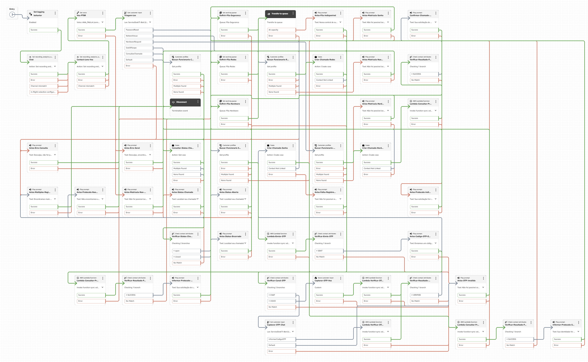
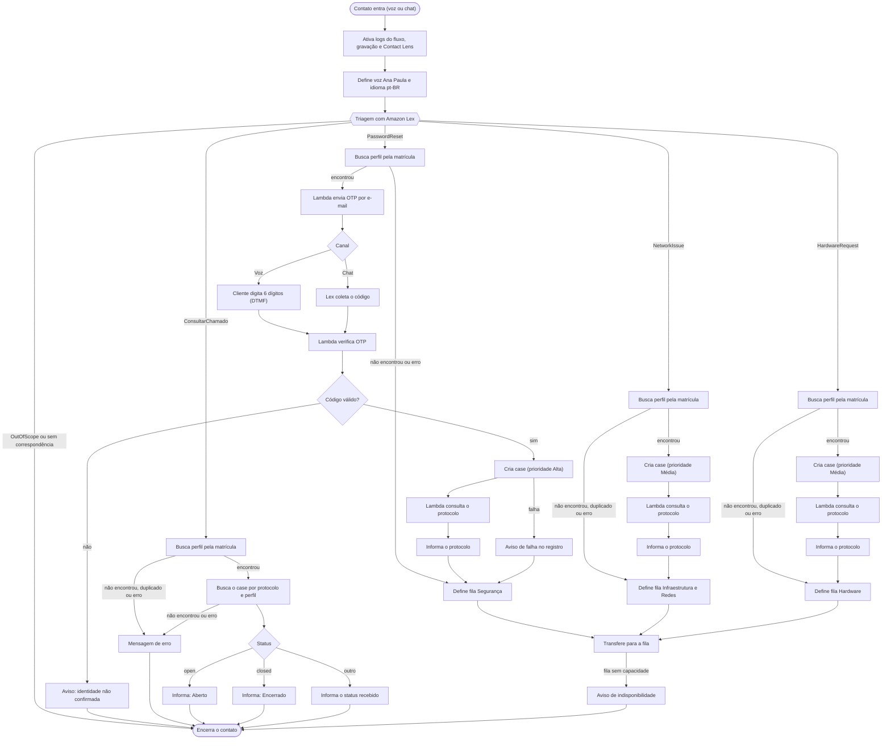
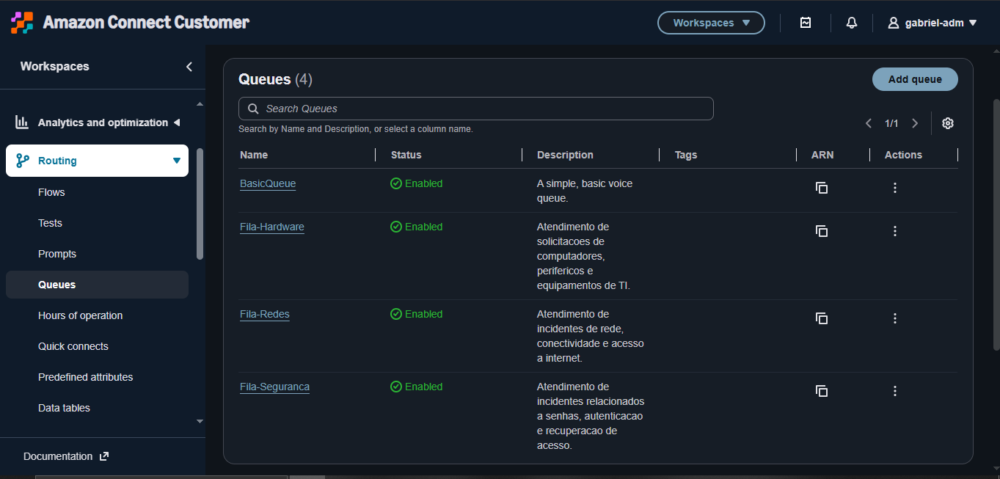
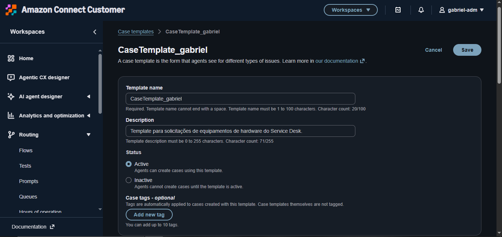
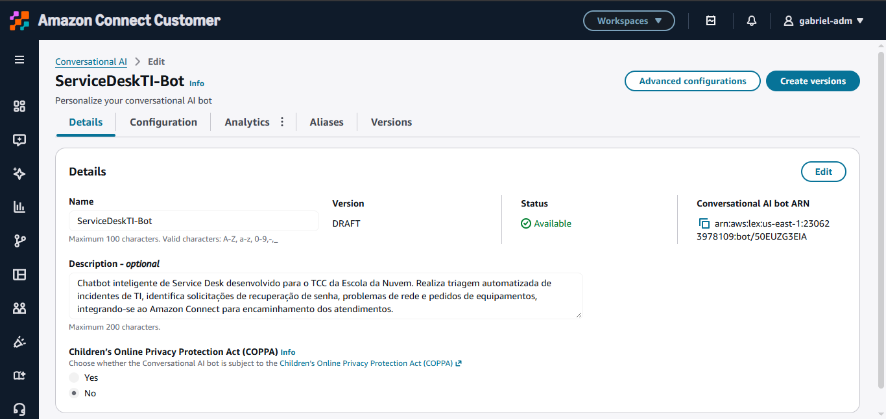
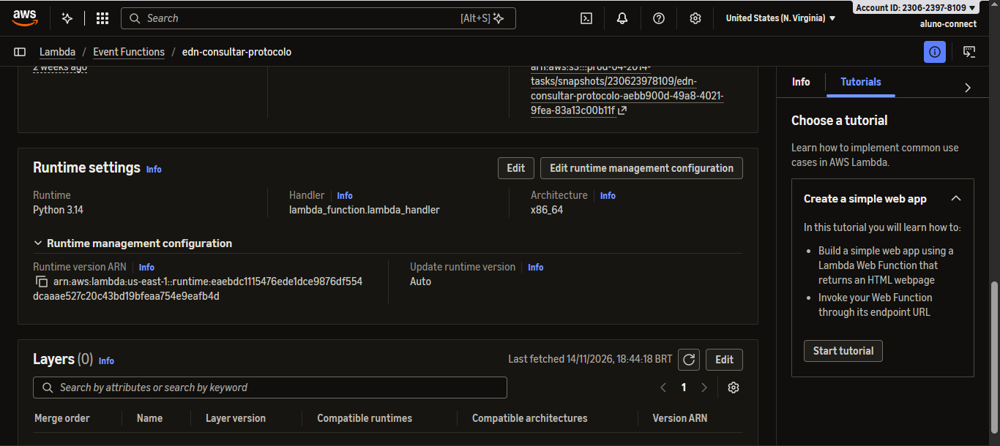
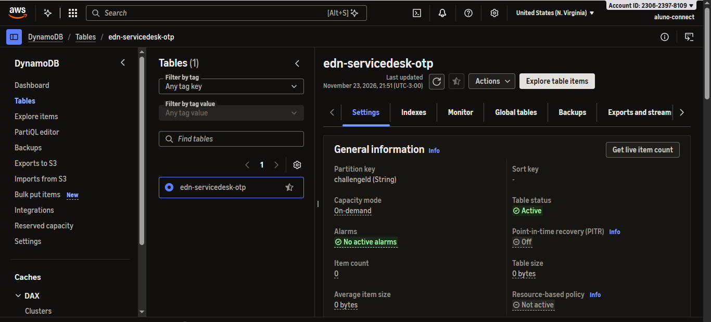
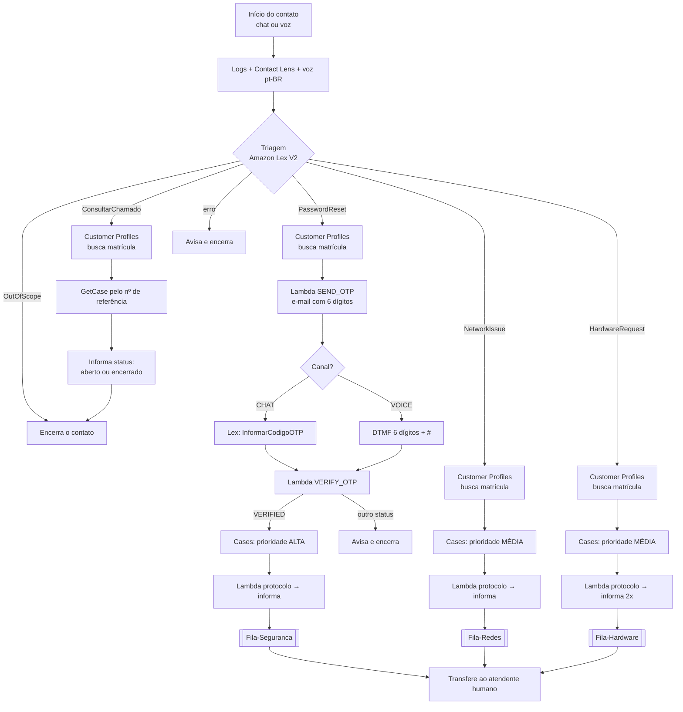
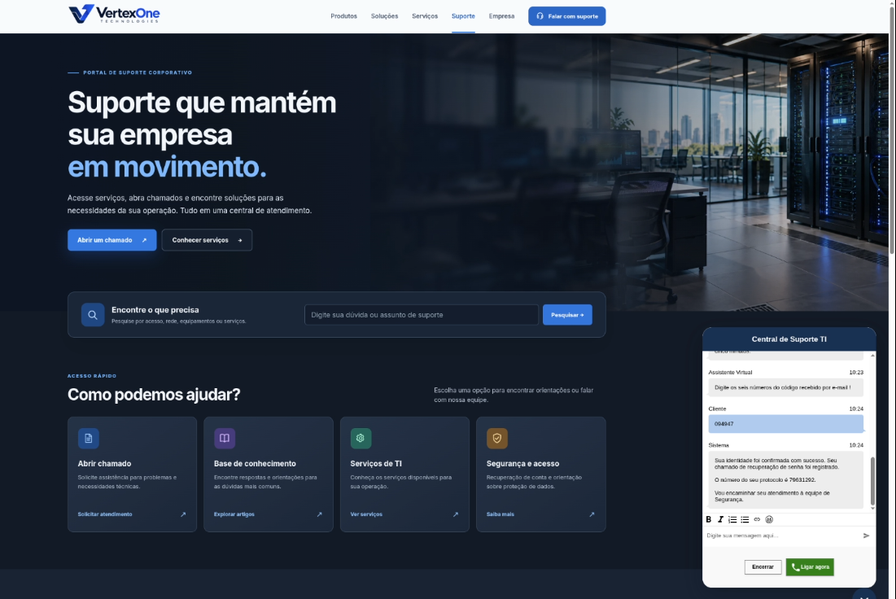
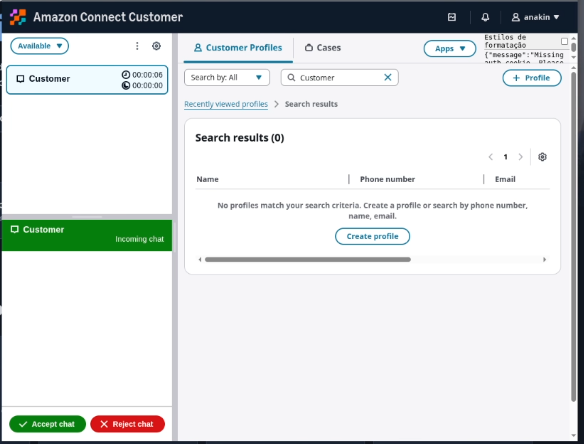

# Service Desk de TI Omnichannel — Amazon Connect

> **Curso Amazon Connect | Escola da Nuvem | Turma Piloto — Case 2: Service Desk Interno (Suporte de TI)**
> Chat online + Voz · IA conversacional (Amazon Lex V2) · Região `us-east-1` · Idioma/voz `pt-BR` (Ana Paula)

---

## Sumário

0. [Resumo executivo](#resumo-executivo)
1. [Tecnologias utilizadas](#1-tecnologias-utilizadas)
2. [Visão geral do projeto](#2-visão-geral-do-projeto)
3. [Requisitos do case e cobertura](#3-requisitos-do-case-e-cobertura)
4. [Arquitetura](#4-arquitetura)
5. [Configuração passo a passo](#5-configuração-passo-a-passo)
   - 5.1 [Instância e canais](#51-instância-do-amazon-connect-e-canais)
   - 5.2 [Customer Profiles](#52-customer-profiles-base-de-funcionários)
   - 5.3 [Filas e roteamento](#53-filas-e-roteamento)
   - 5.4 [Connect Cases](#54-connect-cases-chamados)
   - 5.5 [Amazon Lex V2](#55-amazon-lex-v2-triagem-por-intenção)
   - 5.6 [Funções Lambda](#56-funções-lambda)
   - 5.7 [OTP: DynamoDB e SES](#57-otp-dynamodb-e-ses)
   - 5.8 [Contact Lens](#58-contact-lens-transcrição-e-sentimento)
   - 5.9 [Fluxo de contato](#59-fluxo-de-contato-fluxoservicedesk-ti-teste-protocolo)
6. [Fluxo de atendimento detalhado](#6-fluxo-de-atendimento-detalhado)
7. [Tratamento de falhas](#7-tratamento-de-falhas)
8. [Segurança](#8-segurança)
9. [Métricas para o supervisor (FCR e TMA)](#9-métricas-para-o-supervisor-fcr-e-tma)
10. [Testes realizados](#10-testes-realizados)
11. [Custo estimado mensal](#11-custo-estimado-mensal)
12. [Lista de imagens](#12-lista-de-imagens)
13. [Estrutura do repositório](#13-estrutura-do-repositório)

---

## Resumo executivo

Este projeto implementa um **service desk de TI omnichannel (chat + voz)** no **Amazon Connect** para uma empresa de médio porte, substituindo um help desk sem triagem, em que os colaboradores abriam chamados por e-mail ou ramal, o que gerava fila, falta de priorização e pouca visibilidade dos indicadores.

Um assistente virtual criado com **Amazon Lex V2** (`ServiceDeskTI-Bot`, em pt-BR) identifica o motivo do contato e conduz o atendimento de ponta a ponta:

- **Triagem por intenção:** `PasswordReset`, `NetworkIssue`, `HardwareRequest` e `ConsultarChamado`, além de `OutOfScope` para assuntos fora do escopo.
- **Validação do funcionário** pela matrícula, consultando o **Customer Profiles**.
- **Verificação por OTP** na recuperação de senha: código de 6 dígitos enviado por e-mail (**SES**), validado por **Lambda** com hash armazenado no **DynamoDB**, válido por 5 minutos, de uso único e com no máximo 3 tentativas.
- **Abertura automática do chamado** no **Connect Cases**, com categoria e prioridade (Alta para senha, Média para rede e hardware), e informação do **protocolo** ao usuário.
- **Roteamento para a fila correta:** `Fila-Seguranca`, `Fila-Redes` ou `Fila-Hardware`.
- **Consulta de status** de chamados existentes pelo número de protocolo.
- **Análise de qualidade** com **Contact Lens** (transcrição, sentimento e gravação de voz) e armazenamento no **S3**.

O fluxo trata falhas de forma explícita: matrícula não encontrada, erro ao criar o caso ou ler o protocolo, OTP inválido, fila lotada e erros gerais sempre terminam em transferência para um atendente ou em um encerramento com mensagem clara.

**Resultados esperados:** menor TMA, maior taxa de resolução no primeiro contato (FCR), chamados categorizados e priorizados desde a entrada e indicadores disponíveis para o supervisor.

| Indicador | Valor |
|---|---|
| Intenções configuradas no Lex | 6 (4 de atendimento, 1 de captura de OTP e 1 fora de escopo) |
| Filas de atendimento | 3 |
| Canais | Chat e voz |
| Região | `us-east-1` |
| Custo estimado | US$ 11.146/mês (cerca de US$ 0,37 por ligação) |

---

## 1. Tecnologias utilizadas

| Tecnologia | Papel no projeto |
|---|---|
| **Amazon Connect** | Central de atendimento (chat + voz): fluxo de contato `Fluxo-ServiceDesk-TI-TESTE-Protocolo`, filas, perfis de roteamento e métricas |
| **Amazon Connect Cases** | Abertura e consulta de chamados (template `ServiceDeskTI`) com categoria, prioridade e fila atribuída |
| **Amazon Connect Customer Profiles** | Base de funcionários; validação da identidade pela matrícula (`_account`) |
| **Amazon Lex V2** | Bot `ServiceDeskTI-Bot`: triagem por intenção, captura de matrícula, protocolo e código OTP no chat |
| **AWS Lambda** | `edn-consultar-protocolo` (devolve o nº do protocolo), `edn-validar-identidade-otp` (envia/valida OTP), validação de matrícula do Lex e geração de token JWT do widget de chat |
| **Amazon DynamoDB** | Armazena o desafio OTP (hash HMAC, tentativas, expiração) e o controle de intervalo entre envios |
| **Amazon SES** | Envio do código OTP por e-mail de recuperação |
| **Contact Lens for Amazon Connect** | Transcrição, análise de sentimento (chat e voz) e gravação de voz |
| **Amazon S3** | Armazenamento das gravações de voz e dos dados do Contact Lens |
| **Amazon CloudWatch Logs** | Logs do fluxo, do Lex e das Lambdas |
| **AWS IAM** | Perfis de execução das Lambdas e permissões entre serviços (Connect ↔ Lambda ↔ Lex) |
| **Amazon API Gateway (JWT authorizer)** | Protege a Lambda que emite o token do widget de chat |
| **AWS CloudFormation** | Função auxiliar (custom resource) que define o *alias* da conta IAM |

---

## 2. Visão geral do projeto

Uma empresa de médio porte tinha um help desk de TI sem triagem automática: colaboradores abriam chamados por e-mail ou ligavam para um ramal, o que gerava fila, falta de priorização e baixa visibilidade de indicadores.

A solução é um **service desk omnichannel** (chat online + voz) em que um assistente virtual:

1. identifica o motivo do contato (intenção);
2. valida o funcionário pela matrícula;
3. exige **verificação por OTP** quando a intenção é recuperação de senha;
4. **abre o chamado automaticamente** no Connect Cases com categoria e prioridade;
5. informa o **protocolo** ao usuário;
6. **encaminha para a fila** da equipe correta (Segurança, Redes ou Hardware).

**Objetivo de negócio:** reduzir o TMA (tempo médio de atendimento) e aumentar o FCR (resolução no primeiro contato).

---

## 3. Requisitos do case e cobertura

| Entregável do case | Como foi atendido |
|---|---|
| Fluxo no Connect com ≥ 3 intenções no Lex (`PasswordReset`, `NetworkIssue`, `HardwareRequest`) | Bot `ServiceDeskTI-Bot` com as 3 intenções + `ConsultarChamado`, `OutOfScope` e `InformarCodigoOTP` (captura do código) |
| Filas segmentadas com roteamento automático por intenção | `Fila-Seguranca`, `Fila-Redes`, `Fila-Hardware`; o fluxo define a fila de destino conforme a intenção detectada |
| Integração com Connect Cases (categoria e prioridade) | Template `ServiceDeskTI`: `case_reason` = intenção, prioridade Alta (senha) ou Média (rede/hardware), `assigned_queue`, `customer_id`, `status` aberto |
| Contact Lens (transcrição e sentimento) | Habilitado no fluxo para chat e voz, em `pt-BR`, com gravação de voz |
| Métricas de FCR e TMA para o supervisor | Dashboards/métricas históricas do Connect (ver [seção 9](#9-métricas-para-o-supervisor-fcr-e-tma)) |
| Cenário "solicitação de equipamento" com notificação e acompanhamento | Caso criado automaticamente, protocolo informado duas vezes e consulta de status pela intenção `ConsultarChamado` |

---

## 4. Arquitetura



> 📸 **Imagem 01 — Arquitetura geral:** diagrama (draw.io, Lucidchart ou print do PDF) mostrando Connect, Lex, Lambdas, Customer Profiles, Cases, DynamoDB, SES, S3 e CloudWatch.



---

## 5. Configuração passo a passo

### 5.1 Instância do Amazon Connect e canais

- Região: **us-east-1 (N. Virginia)**.
- Canais habilitados: **Voz** e **Chat**.
- Opções da instância: Contact Lens (análises conversacionais), Customer Profiles, Cases e integração com Lex/Lambda.
- Armazenamento (S3) para gravações de chamadas e dados do Contact Lens.


> 📸 **Imagem 02 — Instância Connect:** tela de *Data storage / Telephony / Flows* da instância (Console AWS → Amazon Connect → instância).

### 5.2 Customer Profiles (base de funcionários)

- Domínio do Customer Profiles associado à instância.
- Cada funcionário é um perfil com **`AccountNumber` = matrícula de 4 dígitos**, nome e e-mail (pessoal/de recuperação).
- O fluxo e a Lambda localizam o perfil pela chave `_account`.

| Campo | Uso |
|---|---|
| `AccountNumber` | Matrícula (chave de busca `_account`) |
| `FirstName`, `MiddleName`, `LastName` | Saudação/identificação |
| `PersonalEmailAddress` / `EmailAddress` | Destino do OTP (prioriza o e-mail pessoal) |
| `ProfileId` | Enviado à Lambda de OTP para vincular o desafio ao perfil |

### 5.3 Filas e roteamento

| Fila | Equipe | Intenção que alimenta |
|---|---|---|
| `Fila-Seguranca` | Segurança da informação | `PasswordReset` (prioridade **Alta**) |
| `Fila-Redes` | Infraestrutura e redes | `NetworkIssue` (prioridade **Média**) |
| `Fila-Hardware` | Hardware / equipamentos | `HardwareRequest` (prioridade **Média**) |

- Cada fila possui horário de funcionamento, número de contato de saída e **perfil de roteamento** com os canais Chat e Voz.
- No fluxo, o bloco **Definir fila de trabalho** (`UpdateContactTargetQueue`) escolhe a fila e o bloco **Transferir para fila** (`TransferContactToQueue`) envia o contato ao atendente.



> 📸 **Imagem 03 — Filas:** Routing → Queues, mostrando `Fila-Seguranca`, `Fila-Redes` e `Fila-Hardware`.

### 5.4 Connect Cases (chamados)

Template **`ServiceDeskTI`** com os campos usados pelo fluxo:

| Campo | Valor gravado pelo fluxo |
|---|---|
| `case_reason` (categoria) | `PasswordReset`, `NetworkIssue` ou `HardwareRequest` |
| Prioridade (campo customizado) | `High` (senha) · `Medium` (rede e hardware) |
| `assigned_queue` | ARN da fila de destino |
| `customer_id` | ARN do perfil do funcionário (`$.Customer.ProfileARN`) |
| `status` | Aberto (`open`) |
| `reference_number` | Gerado pelo Cases; é o **protocolo** informado ao usuário |

O bloco **Criar caso** usa `LinkContactToCase = true`, vinculando o contato ao chamado.



> 📸 **Imagem 04 — Cases:** Cases → Templates → `ServiceDeskTI` com os campos listados acima.

### 5.5 Amazon Lex V2 (triagem por intenção)

**Bot:** `ServiceDeskTI-Bot` · idioma `pt-BR` · voz Ana Paula (Polly).

| Intenção | Finalidade | Slots principais |
|---|---|---|
| `PasswordReset` | Recuperação de senha (exige OTP) | `MatriculaFuncionario` |
| `NetworkIssue` | Problema de rede / internet | `MatriculaFuncionario` |
| `HardwareRequest` | Solicitação de equipamento | `MatriculaFuncionario` |
| `ConsultarChamado` | Consulta de status de chamado | `MatriculaConsulta`, `NumeroProtocolo` |
| `InformarCodigoOTP` | Captura do código OTP no **chat** | `CodigoOTP` |
| `OutOfScope` (fallback) | Assuntos fora do escopo → encerra o contato | — |

- O **code hook de diálogo** do slot de matrícula chama a Lambda de validação (ver 5.6), que exige 4 dígitos e confirma a existência no Customer Profiles.
- O bot possui **alias** associado à instância do Connect (permissão de invocação concedida em *Flows → Amazon Lex*).


> 📸 **Imagem 05 — Lex, Intenções:** Console Lex V2 → `ServiceDeskTI-Bot` → idioma pt-BR → Intents.


> 📸 **Imagem 06 — Lex, detalhe de intenção:** `PasswordReset` com *sample utterances*, slot `MatriculaFuncionario` e o *code hook* habilitado.



> 📸 **Imagem 07 — Lex, alias e integração:** alias do bot e tela *Amazon Connect → Flows → Amazon Lex* com o bot adicionado.

### 5.6 Funções Lambda

| Função | Quem chama | O que faz |
|---|---|---|
| `edn-consultar-protocolo` | Fluxo do Connect | Lê o `reference_number` do caso criado e devolve o protocolo |
| `edn-validar-identidade-otp` | Fluxo do Connect | Ações `SEND_OTP` e `VERIFY_OTP` |
| Validação de matrícula | Lex (*code hook*) | Valida formato e existência da matrícula no Customer Profiles |
| Validação JWT (widget) | API Gateway | Emite token HS256 de 5 min para o widget de chat (exige claim `sub` do autorizador) |
| Função auxiliar (CloudFormation) | Custom resource | Cria/atualiza o *alias* da conta IAM |


> 📸 **Imagem 08 — Lambda `edn-consultar-protocolo`:** visão geral da função no console (arquivo já existente: `imagem/Lambda_Consultar_Protocolo.png`).



> 📸 **Imagem 09 — Lambda, configuração:** aba *Configuration* → *Environment variables* e *Permissions* (oculte valores secretos antes do print).

#### 5.6.1 `edn-consultar-protocolo`

**Em palavras simples:** depois que o chamado é criado, esta função "pergunta" ao Connect Cases qual é o **número do protocolo** daquele chamado, para o assistente poder falar o número para o funcionário. Se o chamado ainda não apareceu no sistema, ela espera um pouco e tenta de novo (até 3 vezes).

| Item | Detalhe |
|---|---|
| Quem chama | Fluxo do Connect (bloco *Invocar função AWS Lambda*) |
| Recebe | `caseId` (ID do chamado criado) |
| Devolve | `status` (`SUCCESS`, `NOT_FOUND`, `ERROR`, `CONFIG_ERROR`) e `referenceNumber` (o protocolo) |
| Variável de ambiente | `CASES_DOMAIN_ID` |
| Permissão IAM | `connectcases:GetCase` |

```python
import os
import re
import time

import boto3
from botocore.config import Config
from botocore.exceptions import ClientError

cases = boto3.client(
    "connectcases",
    region_name="us-east-1",
    config=Config(
        connect_timeout=1,
        read_timeout=2,
        retries={"max_attempts": 1}
    )
)

def lambda_handler(event, context):
    params = event.get("Details", {}).get("Parameters", {})
    case_id = params.get("caseId") or event.get("caseId")
    domain_id = os.environ.get("CASES_DOMAIN_ID", "")

    if not case_id or not re.fullmatch(
        r"[0-9a-fA-F-]{36}", str(case_id)
    ):
        return {"status": "ERROR", "referenceNumber": ""}

    if not domain_id:
        return {"status": "CONFIG_ERROR", "referenceNumber": ""}

    for attempt in range(3):
        try:
            response = cases.get_case(
                domainId=domain_id,
                caseId=case_id,
                fields=[{"id": "reference_number"}]
            )

            for field in response.get("fields", []):
                if field.get("id") == "reference_number":
                    number = field.get("value", {}).get(
                        "stringValue", ""
                    )
                    if number:
                        return {
                            "status": "SUCCESS",
                            "referenceNumber": str(number)
                        }

            return {"status": "NOT_FOUND", "referenceNumber": ""}

        except cases.exceptions.ResourceNotFoundException:
            if attempt < 2:
                time.sleep(0.6 * (attempt + 1))
                continue
            return {"status": "NOT_FOUND", "referenceNumber": ""}

        except ClientError as error:
            print("GetCase error:", error.response[
                "Error"
            ].get("Code", "Unknown"))
            return {"status": "ERROR", "referenceNumber": ""}

    return {"status": "NOT_FOUND", "referenceNumber": ""}
```

#### 5.6.2 `edn-validar-identidade-otp`

**Em palavras simples:** garante que quem pede a recuperação de senha é mesmo o funcionário. Funciona em duas etapas: (1) **`SEND_OTP`** gera um código de 6 dígitos, guarda uma versão criptografada dele no DynamoDB e envia o código por e-mail; (2) **`VERIFY_OTP`** confere o código digitado pelo usuário. O código vale 5 minutos, só pode ser usado uma vez e o usuário tem no máximo 3 tentativas.

| Item | Detalhe |
|---|---|
| Quem chama | Fluxo do Connect (somente; sem URL pública) |
| Recebe | `action` (`SEND_OTP` ou `VERIFY_OTP`), `profileId`, `matricula` e, na verificação, `code` |
| Devolve | `SENT`, `WAIT`, `VERIFIED`, `INVALID`, `EXPIRED`, `LOCKED` ou `UNAVAILABLE` |
| Variáveis de ambiente | `OTP_TABLE`, `SES_FROM_EMAIL`, `CUSTOMER_PROFILES_DOMAIN`, `OTP_HMAC_KEY` (mínimo 32 caracteres) |
| Permissões IAM | `profile:BatchGetProfile`, `ses:SendEmail`, `dynamodb:GetItem/PutItem/UpdateItem/DeleteItem` |

```python
"""EDN Service Desk - verificacao OTP para Amazon Connect (laboratorio).

Requisitos:
- Lambda chamada exclusivamente pelo Connect (sem Function URL/API publica).
- Ambiente: OTP_TABLE, SES_FROM_EMAIL, CUSTOMER_PROFILES_DOMAIN, OTP_HMAC_KEY.
- IAM: profile:BatchGetProfile, ses:SendEmail, dynamodb:{GetItem,PutItem,UpdateItem,DeleteItem}.
- Connect envia Details.Parameters.action, profileId e matricula; codigo somente em VERIFY_OTP.
- A identidade nao deve ser tratada como autenticada sem status VERIFIED.

Nunca registre o evento completo: ele pode conter o codigo OTP.
"""

import hashlib
import hmac
import logging
import os
import re
import secrets
import time

import boto3
from botocore.exceptions import ClientError

log = logging.getLogger(__name__)
log.setLevel(logging.INFO)

REGION = os.environ.get("AWS_REGION", "us-east-1")
TABLE_NAME = os.environ.get("OTP_TABLE", "")
SENDER = os.environ.get("SES_FROM_EMAIL", "")
DOMAIN = os.environ.get("CUSTOMER_PROFILES_DOMAIN", "")
HMAC_KEY = os.environ.get("OTP_HMAC_KEY", "")

OTP_LIFETIME_SECONDS = 300
PROFILE_COOLDOWN_SECONDS = 60
MAX_ATTEMPTS = 3


def _clients():
    return (
        boto3.resource("dynamodb", region_name=REGION).Table(TABLE_NAME),
        boto3.client("customer-profiles", region_name=REGION),
        boto3.client("ses", region_name=REGION),
    )


def _response(status):
    # Resposta simples e compativel com o atributo External de Lambda do Connect.
    return {"status": status}


def _digest(contact_id, profile_id, otp):
    payload = f"{contact_id}:{profile_id}:{otp}".encode("utf-8")
    return hmac.new(HMAC_KEY.encode("utf-8"), payload, hashlib.sha256).hexdigest()


def _profile(profiles_client, profile_id, matricula):
    # Nao aceita e-mail informado pelo contato: le o perfil oficial da AWS.
    result = profiles_client.batch_get_profile(DomainName=DOMAIN, ProfileIds=[profile_id])
    records = result.get("Profiles", [])
    if len(records) != 1 or records[0].get("ProfileId") != profile_id:
        return None
    profile = records[0]
    if str(profile.get("AccountNumber") or "") != matricula:
        return None
    return profile


def _send(event, table, profiles_client, ses_client, now, contact_id, profile_id, matricula):
    if not re.fullmatch(r"\d{4}", matricula):
        return _response("UNAVAILABLE")

    profile = _profile(profiles_client, profile_id, matricula)
    if not profile:
        return _response("UNAVAILABLE")

    # Preferir e-mail de recuperacao independente da conta corporativa bloqueada.
    address = (profile.get("PersonalEmailAddress") or profile.get("EmailAddress") or "").strip()
    if not address or "@" not in address:
        return _response("UNAVAILABLE")

    # Limite minimo entre envios por funcionario, inclusive em contatos distintos.
    rate_id = f"RATE#{profile_id}"
    try:
        table.put_item(
            Item={"challengeId": rate_id, "expiresAt": now + PROFILE_COOLDOWN_SECONDS},
            ConditionExpression="attribute_not_exists(challengeId) OR expiresAt <= :now",
            ExpressionAttributeValues={":now": now},
        )
    except ClientError as exc:
        if exc.response.get("Error", {}).get("Code") == "ConditionalCheckFailedException":
            return _response("WAIT")
        raise

    otp = f"{secrets.randbelow(1000000):06d}"
    try:
        # Chave vinculada ao ContactId; um codigo de outro chat nao sera aceito.
        table.put_item(
            Item={
                "challengeId": contact_id,
                "profileId": profile_id,
                "accountNumber": matricula,
                "digest": _digest(contact_id, profile_id, otp),
                "attempts": 0,
                "used": False,
                "expiresAt": now + OTP_LIFETIME_SECONDS,
            },
            ConditionExpression="attribute_not_exists(challengeId) OR expiresAt <= :now",
            ExpressionAttributeValues={":now": now},
        )
    except ClientError as exc:
        if exc.response.get("Error", {}).get("Code") == "ConditionalCheckFailedException":
            return _response("WAIT")
        raise

    try:
        # Mensagem montada separadamente para evitar erros de chaves aninhadas.
        body_text = (
            f"Seu codigo de verificacao e: {otp}\n\n"
            "Valido por 5 minutos e para uso unico. "
            "Nao compartilhe com atendentes ou terceiros.\n\n"
            "Se voce nao solicitou esta verificacao, ignore este e-mail."
        )
        subject = {
            "Data": "Codigo de verificacao - Service Desk de TI",
            "Charset": "UTF-8",
        }
        body = {
            "Text": {
                "Data": body_text,
                "Charset": "UTF-8",
            }
        }
        message = {"Subject": subject, "Body": body}
        ses_client.send_email(
            Source=SENDER,
            Destination={"ToAddresses": [address]},
            Message=message,
        )
    except ClientError as exc:
        # Diagnostico sem expor e-mail, OTP, evento ou mensagem integral do SES.
        error = exc.response.get("Error", {})
        error_code = str(error.get("Code") or "Unknown")
        description = str(error.get("Message") or "").lower()
        if "not verified" in description or "not verified" in error_code.lower():
            category = "IDENTITY_NOT_VERIFIED"
        elif "not authorized" in description or "access denied" in description or "accessdenied" in error_code.lower():
            category = "IAM_DENIED"
        elif "sandbox" in description:
            category = "SES_SANDBOX"
        elif "sending paused" in description or "account is paused" in description:
            category = "SES_SENDING_PAUSED"
        else:
            category = "SES_OTHER"
        # Logue apenas metadados seguros do AccessDenied, nunca o erro integral.
        # A mensagem do SES pode revelar destinatario ou identidade do remetente.
        reason_keys = (
            ("service control policy", "SCP"),
            ("organization policy", "ORGANIZATION_POLICY"),
            ("permissions boundary", "PERMISSIONS_BOUNDARY"),
            ("session policy", "SESSION_POLICY"),
            ("vpc endpoint policy", "VPC_ENDPOINT_POLICY"),
            ("resource-based policy", "RESOURCE_POLICY"),
            ("identity-based policy", "IDENTITY_POLICY"),
            ("explicit deny", "EXPLICIT_DENY"),
            ("no policy allows", "NO_MATCHING_ALLOW"),
            ("not authorized", "NOT_AUTHORIZED_UNSPECIFIED"),
        )
        reason = next((name for phrase, name in reason_keys if phrase in description), "NOT_STATED")
        denied_action = re.search(r"ses:(SendEmail|SendRawEmail|SendBulkEmail)", description, re.I)
        arn_match = re.search(
            r"arn:aws:ses:([a-z0-9-]+):([0-9]{12}):(identity|configuration-set)/([^\s,;\"']+)",
            description, re.I,
        )
        resource_kind = arn_match.group(3) if arn_match else "UNSTATED"
        # Diagnostico de recurso: so indicadores, nunca valores de e-mail ou OTP.
        # Permite diferenciar ARN do remetente, ARN do destinatario e dominio.
        if arn_match and resource_kind == "identity":
            denied_identity = arn_match.group(4).rstrip(".>)").strip().lower()
            identity_matches_sender = denied_identity == SENDER.strip().lower()
            identity_matches_recipient = denied_identity == address.strip().lower()
            denied_identity_is_domain = "@" not in denied_identity
            denied_region_matches = arn_match.group(1).lower() == REGION.lower()
            denied_account_matches = arn_match.group(2) == "<ID_DA_CONTA_AWS>"
        else:
            identity_matches_sender = "UNKNOWN"
            identity_matches_recipient = "UNKNOWN"
            denied_identity_is_domain = "UNKNOWN"
            denied_region_matches = "UNKNOWN"
            denied_account_matches = "UNKNOWN"
        sender_has_extra_spaces = SENDER != SENDER.strip()
        request_id = (exc.response.get("ResponseMetadata") or {}).get("RequestId", "UNSTATED")
        table.delete_item(Key={"challengeId": contact_id})
        log.warning(
            "SES_SEND_FAILED code=%s category=%s reason=%s denied_action=%s "
            "resource_type=%s matches_sender=%s matches_recipient=%s "
            "is_domain=%s region_ok=%s account_ok=%s sender_spaces=%s request_region=%s aws_request_id=%s",
            error_code, category, reason,
            denied_action.group(0) if denied_action else "UNSTATED",
            resource_kind, identity_matches_sender, identity_matches_recipient,
            denied_identity_is_domain, denied_region_matches, denied_account_matches,
            sender_has_extra_spaces, REGION, request_id,
        )
        return _response("UNAVAILABLE")

    return _response("SENT")


def _verify(params, table, now, contact_id, profile_id, matricula):
    otp = str(params.get("code") or "").strip()
    if not re.fullmatch(r"\d{6}", otp):
        return _response("INVALID")

    result = table.get_item(Key={"challengeId": contact_id}, ConsistentRead=True)
    challenge = result.get("Item")
    if not challenge:
        return _response("UNAVAILABLE")

    if (challenge.get("profileId") != profile_id
            or challenge.get("accountNumber") != matricula
            or challenge.get("used") is True):
        return _response("UNAVAILABLE")

    if int(challenge.get("expiresAt", 0)) <= now:
        return _response("EXPIRED")
    if int(challenge.get("attempts", 0)) >= MAX_ATTEMPTS:
        return _response("LOCKED")

    if hmac.compare_digest(challenge.get("digest", ""), _digest(contact_id, profile_id, otp)):
        try:
            # Atualizacao condicional atomica impede reutilizacao da mesma prova.
            table.update_item(
                Key={"challengeId": contact_id},
                UpdateExpression="SET used = :yes",
                ConditionExpression=(
                    "profileId = :profile AND accountNumber = :account "
                    "AND digest = :digest AND used = :no "
                    "AND attempts < :max AND expiresAt > :now"
                ),
                ExpressionAttributeValues={
                    ":profile": profile_id,
                    ":account": matricula,
                    ":digest": challenge["digest"],
                    ":yes": True,
                    ":no": False,
                    ":max": MAX_ATTEMPTS,
                    ":now": now,
                },
            )
        except ClientError as exc:
            if exc.response.get("Error", {}).get("Code") == "ConditionalCheckFailedException":
                return _response("UNAVAILABLE")
            raise
        return _response("VERIFIED")

    try:
        result = table.update_item(
            Key={"challengeId": contact_id},
            UpdateExpression="ADD attempts :one",
            ConditionExpression=(
                "profileId = :profile AND accountNumber = :account AND used = :no "
                "AND attempts < :max AND expiresAt > :now"
            ),
            ExpressionAttributeValues={
                ":one": 1,
                ":profile": profile_id,
                ":account": matricula,
                ":no": False,
                ":max": MAX_ATTEMPTS,
                ":now": now,
            },
            ReturnValues="UPDATED_NEW",
        )
    except ClientError as exc:
        if exc.response.get("Error", {}).get("Code") == "ConditionalCheckFailedException":
            return _response("LOCKED")
        raise
    attempts = int(result.get("Attributes", {}).get("attempts", MAX_ATTEMPTS))
    return _response("LOCKED" if attempts >= MAX_ATTEMPTS else "INVALID")


def lambda_handler(event, context):
    if not (TABLE_NAME and SENDER and DOMAIN and len(HMAC_KEY) >= 32):
        log.error("Configuracao de ambiente incompleta.")
        return _response("UNAVAILABLE")

    details = event.get("Details") or {}
    params = details.get("Parameters") or {}
    contact = details.get("ContactData") or {}
    action = str(params.get("action") or "").upper()
    contact_id = str(contact.get("ContactId") or "").strip()
    profile_id = str(params.get("profileId") or "").strip()
    matricula = str(params.get("matricula") or "").strip()
    if not contact_id or not profile_id or not re.fullmatch(r"\d{4}", matricula):
        return _response("UNAVAILABLE")
    if action not in ("SEND_OTP", "VERIFY_OTP"):
        return _response("UNAVAILABLE")

    now = int(time.time())
    try:
        table, profiles_client, ses_client = _clients()
        if action == "SEND_OTP":
            return _send(event, table, profiles_client, ses_client, now, contact_id, profile_id, matricula)
        return _verify(params, table, now, contact_id, profile_id, matricula)
    except Exception:
        # Nunca imprimir o evento ou codigo recebido no log.
        log.exception("Falha operacional da verificacao OTP.")
        return _response("UNAVAILABLE")
```

> O ID da conta AWS que aparecia no código original foi substituído por `<ID_DA_CONTA_AWS>`.

#### 5.6.3 Validação de matrícula (*code hook* do Lex)

**Em palavras simples:** é o "porteiro" da matrícula. Quando o usuário digita a matrícula no chat ou na voz, o Lex chama esta função para conferir se tem **4 números** e se existe no cadastro de funcionários (Customer Profiles). Se estiver errada, ela pede para digitar de novo. Se estiver certa, ela guarda o nome e o ID do perfil da conversa e deixa o Lex seguir.

| Item | Detalhe |
|---|---|
| Quem chama | Amazon Lex V2 (*code hook* do slot `MatriculaFuncionario`) |
| Recebe | Evento do Lex com o valor do slot |
| Devolve | Resposta do Lex: `ElicitSlot` (pede de novo), `Delegate` (segue) ou `Close` (erro) |
| Grava na sessão | `matriculaValidada`, `nomeFuncionario`, `perfilId` |
| Variável de ambiente | `CUSTOMER_PROFILES_DOMAIN` |
| Permissão IAM | `profile:SearchProfiles` |

```python
import os
import re
import boto3
import logging
from botocore.exceptions import ClientError, BotoCoreError

logger = logging.getLogger()
logger.setLevel(logging.INFO)

profiles = boto3.client("customer-profiles")


def lambda_handler(event, context):
    estado = event.get("sessionState") or {}
    intent = estado.get("intent") or {}
    slots = intent.get("slots") or {}
    atributos = estado.get("sessionAttributes") or {}

    campo = slots.get("MatriculaFuncionario") or {}
    valor = campo.get("value") or {}
    matricula = str(valor.get("interpretedValue") or "").strip()

    def resposta(acao, mensagem=None):
        resultado = {
            "sessionState": {
                "dialogAction": acao,
                "intent": intent,
                "sessionAttributes": atributos
            }
        }
        if mensagem:
            resultado["messages"] = [{
                "contentType": "PlainText",
                "content": mensagem
            }]
        return resultado

    def pedir_matricula(mensagem):
        slots["MatriculaFuncionario"] = None
        intent["slots"] = slots
        intent["state"] = "InProgress"
        return resposta(
            {
                "type": "ElicitSlot",
                "slotToElicit": "MatriculaFuncionario"
            },
            mensagem
        )

    if not re.fullmatch(r"[0-9]{4}", matricula):
        return pedir_matricula(
            "Informe uma matricula de quatro numeros."
        )

    dominio = os.environ.get("CUSTOMER_PROFILES_DOMAIN")

    if not dominio:
        logger.error("Dominio nao configurado")
        intent["state"] = "Failed"
        return resposta(
            {"type": "Close"},
            "Sistema de validacao indisponivel."
        )

    try:
        consulta = profiles.search_profiles(
            DomainName=dominio,
            KeyName="_account",
            Values=[matricula],
            MaxResults=20
        )
    except (ClientError, BotoCoreError):
        logger.exception("Erro na consulta de perfis")
        intent["state"] = "Failed"
        return resposta(
            {"type": "Close"},
            "Nao foi possivel validar seu cadastro."
        )

    encontrados = [
        perfil for perfil in consulta.get("Items", [])
        if perfil.get("AccountNumber") == matricula
    ]

    if not encontrados:
        return pedir_matricula(
            "Matricula nao encontrada. Tente novamente."
        )

    if len(encontrados) != 1 or consulta.get("NextToken"):
        intent["state"] = "Failed"
        return resposta(
            {"type": "Close"},
            "Cadastro ambiguo. Contate o suporte."
        )

    funcionario = encontrados[0]

    nome = " ".join(filter(None, [
        funcionario.get("FirstName"),
        funcionario.get("MiddleName"),
        funcionario.get("LastName")
    ]))

    atributos["matriculaValidada"] = matricula
    atributos["nomeFuncionario"] = nome
    atributos["perfilId"] = funcionario.get("ProfileId", "")

    return resposta({"type": "Delegate"})
```

#### 5.6.4 Validação JWT do widget de chat

**Em palavras simples:** gera uma "senha temporária" (token) de 5 minutos para o **widget de chat** do site conseguir abrir uma conversa com o Connect. Só entrega o token se quem pediu estiver autenticado no API Gateway; caso contrário responde "autenticação obrigatória" (erro 401).

| Item | Detalhe |
|---|---|
| Quem chama | Amazon API Gateway com autorizador JWT |
| Devolve | `{"data": "<token>"}` (válido por 300 s) ou erro 401/500 |
| Variável de ambiente | `CONNECT_WIDGET_SECRET` |

```python
import os
import json
import time
import hmac
import hashlib
import base64

WIDGET_ID = "<ID_DO_WIDGET_DO_CONNECT>"
TOKEN_VALIDITY_SECONDS = 300  # 5 minutos


def encode_base64url(data):
    return base64.urlsafe_b64encode(data).rstrip(b"=").decode("ascii")


def create_token(secret):
    now = int(time.time())

    header = {
        "alg": "HS256",
        "typ": "JWT"
    }

    payload = {
        "sub": WIDGET_ID,
        "iat": now,
        "exp": now + TOKEN_VALIDITY_SECONDS
    }

    header_encoded = encode_base64url(
        json.dumps(header, separators=(",", ":")).encode()
    )

    payload_encoded = encode_base64url(
        json.dumps(payload, separators=(",", ":")).encode()
    )

    content = f"{header_encoded}.{payload_encoded}"

    signature = hmac.new(
        secret.encode("utf-8"),
        content.encode("ascii"),
        hashlib.sha256
    ).digest()

    return f"{content}.{encode_base64url(signature)}"


def lambda_handler(event, context):
    # Exige que a chamada venha de uma API Gateway
    # configurada com autorizador JWT.
    request_context = event.get("requestContext") or {}
    authorizer = request_context.get("authorizer") or {}
    jwt_context = authorizer.get("jwt") or {}
    claims = jwt_context.get("claims") or {}

    if not isinstance(claims, dict) or not claims.get("sub"):
        return {
            "statusCode": 401,
            "headers": {"Cache-Control": "no-store"},
            "body": json.dumps({
                "error": "Autenticacao obrigatoria"
            })
        }

    secret = os.environ.get("CONNECT_WIDGET_SECRET")

    if not secret:
        return {
            "statusCode": 500,
            "body": json.dumps({
                "error": "Configuracao indisponivel"
            })
        }

    token = create_token(secret)

    return {
        "statusCode": 200,
        "headers": {
            "Content-Type": "application/json",
            "Cache-Control": "no-store"
        },
        "body": json.dumps({"data": token})
    }
```

> O ID do widget do código original foi substituído por `<ID_DO_WIDGET_DO_CONNECT>`.

#### 5.6.5 Função auxiliar do CloudFormation (alias da conta IAM)

**Em palavras simples:** é uma função de apoio à infraestrutura, e não do atendimento. Quando o CloudFormation cria a stack, ela define um **apelido (alias) para a conta AWS**, usado no endereço de login do console. Se o nome já estiver em uso por outra conta no mundo, ela acrescenta o ID da conta. Ao apagar a stack, ela remove o alias sem travar a exclusão.

| Item | Detalhe |
|---|---|
| Quem chama | CloudFormation (*custom resource*) |
| Recebe | `Prefixo`, `UsarNomeDaConta`, `AnexarId` |
| Devolve | Alias criado (`Alias`) ou erro, via `cfnresponse` |
| Permissões IAM | `iam:ListAccountAliases`, `iam:CreateAccountAlias`, `iam:DeleteAccountAlias`, `account:GetAccountInformation` |

```python
import re
import unicodedata

import boto3
import cfnresponse

iam = boto3.client("iam")
account = boto3.client("account")


def slug(texto):
    texto = unicodedata.normalize("NFKD", texto).encode("ascii", "ignore").decode()
    texto = re.sub(r"[^a-z0-9]+", "-", texto.lower())
    return texto.strip("-")


def montar_alias(prefixo, nome, account_id, com_id):
    base = "-".join(p for p in (slug(prefixo), slug(nome)) if p)
    if com_id or len(base) < 3:
        base = base[:50].strip("-") or "conta"
        return base + "-" + account_id
    return base[:63].strip("-")


def handler(event, context):
    tipo = event["RequestType"]
    props = event.get("ResourceProperties", {})
    physical_id = event.get("PhysicalResourceId") or context.log_stream_name
    account_id = context.invoked_function_arn.split(":")[4]
    try:
        existentes = iam.list_account_aliases().get("AccountAliases", [])

        if tipo == "Delete":
            if physical_id in existentes:
                iam.delete_account_alias(AccountAlias=physical_id)
            cfnresponse.send(event, context, cfnresponse.SUCCESS, {}, physical_id)
            return

        nome = ""
        if props.get("UsarNomeDaConta") == "true":
            if not hasattr(account, "get_account_information"):
                raise RuntimeError("boto3 do runtime nao tem account.get_account_information")
            nome = account.get_account_information()["AccountName"]

        prefixo = props.get("Prefixo", "")
        forcar_id = props.get("AnexarId") == "true"
        alias = montar_alias(prefixo, nome, account_id, forcar_id)
        alias_com_id = montar_alias(prefixo, nome, account_id, True)

        # se a conta ja tem um dos dois, mantem
        atual = next((a for a in (alias, alias_com_id) if a in existentes), None)
        if atual:
            alias = atual
        else:
            # a conta so pode ter 1 alias: remove o atual (se houver) antes de criar
            for velho in existentes:
                iam.delete_account_alias(AccountAlias=velho)
            try:
                iam.create_account_alias(AccountAlias=alias)
            except iam.exceptions.EntityAlreadyExistsException:
                # alias ja usado por outra conta no mundo: tenta com o ID da conta
                alias = alias_com_id
                iam.create_account_alias(AccountAlias=alias)

        cfnresponse.send(event, context, cfnresponse.SUCCESS, {"Alias": alias}, alias)
    except Exception as e:
        print("Erro:", repr(e))
        # no Delete nunca falha, para nao travar a remocao da stack
        status = cfnresponse.SUCCESS if tipo == "Delete" else cfnresponse.FAILED
        cfnresponse.send(event, context, status, {"Error": str(e)}, physical_id)
```

### 5.7 OTP: DynamoDB e SES

**Tabela DynamoDB** (nome na variável `OTP_TABLE`):

| Atributo | Descrição |
|---|---|
| `challengeId` *(chave de partição)* | `ContactId` (desafio) ou `RATE#<profileId>` (limitador de envios) |
| `profileId`, `accountNumber` | Vínculo do desafio com o funcionário |
| `digest` | HMAC-SHA256 do código (o código em si **não** é armazenado) |
| `attempts`, `used` | Controle de tentativas e uso único |
| `expiresAt` | Epoch de expiração (ideal: habilitar **TTL** neste atributo) |

**Amazon SES:** identidade do remetente verificada (`SES_FROM_EMAIL`). Em conta *sandbox*, o destinatário também precisa estar verificado.



> 📸 **Imagem 10 — OTP:** tabela DynamoDB (itens/atributos) e identidade verificada no SES. Não exponha e-mails reais nem códigos.

### 5.8 Contact Lens (transcrição e sentimento)

Configurado no início do fluxo (blocos *Definir comportamento de gravação e análise*):

| Canal | Configuração |
|---|---|
| **Chat** | Análises do Contact Lens habilitadas · idioma `pt-BR` · **análise de sentimento** ligada · redação desativada |
| **Voz** | Gravação de **agente e cliente** + gravação da URA · análises `PostContact` e `AutomatedInteraction` · idioma `pt-BR` · **análise de sentimento** ligada |


> 📸 **Imagem 11 — Contact Lens:** blocos de gravação/análise do fluxo (chat e voz) e/ou a página de análise de uma conversa com transcrição e sentimento.

### 5.9 Fluxo de contato `Fluxo-ServiceDesk-TI-TESTE-Protocolo`

Fluxo do tipo *Contact flow* com 53 blocos. Estrutura de entrada:

1. **Habilitar logs do fluxo** (`FlowLoggingBehavior = Enabled`).
2. **Contact Lens – chat** → **Contact Lens – voz**.
3. **Definir voz** `Ana Paula` e **idioma** `pt-BR`.
4. **Triagem com Lex** (`ConnectParticipantWithLexBot`) com a mensagem de boas-vindas e ramificação por intenção.


> 📸 **Imagem 12 — Fluxo completo:** editor do Connect com o fluxo inteiro (use *zoom to fit*), de preferência com as 4 ramificações visíveis.


> 📸 **Imagem 13 — Ramo `PasswordReset`:** Customer Profiles → Lambda `SEND_OTP` → verificação de canal (Lex/DTMF) → Lambda `VERIFY_OTP` → Cases → protocolo → fila.


> 📸 **Imagem 14 — Bloco "Criar caso":** painel de propriedades mostrando template `ServiceDeskTI`, `case_reason`, prioridade e `assigned_queue`.

---

## 6. Fluxo de atendimento detalhado



### Resumo por intenção

| Intenção | Passos | Prioridade | Destino |
|---|---|---|---|
| **PasswordReset** | Busca matrícula → envia OTP → valida (Lex no chat / DTMF na voz) → cria caso → consulta protocolo → informa | **Alta** | `Fila-Seguranca` |
| **NetworkIssue** | Busca matrícula → cria caso → consulta protocolo → informa o número | Média | `Fila-Redes` |
| **HardwareRequest** | Busca matrícula → cria caso → consulta protocolo → informa o número **duas vezes** (para anotação) | Média | `Fila-Hardware` |
| **ConsultarChamado** | Busca funcionário (`MatriculaConsulta`) → `GetCase` pelo nº de referência (`NumeroProtocolo`) → informa protocolo, assunto e status | — | Encerra o contato |
| **OutOfScope** | Encerra o contato | — | — |

### Mensagens-chave do fluxo

- **Boas-vindas:** apresenta a assistente virtual e as opções (senha, rede, equipamento, consulta de chamado).
- **OTP enviado:** informa que um código de seis dígitos foi enviado ao e-mail de recuperação, válido por cinco minutos.
- **Voz (OTP):** "Digite os seis números do código recebido por e-mail e pressione `#` para confirmar" (timeout total 150 s; 12 s entre dígitos).
- **Protocolo:** "O número do seu protocolo é *X*" (rede e hardware repetem o número para anotação).

---

## 7. Tratamento de falhas

| Situação | Comportamento |
|---|---|
| Matrícula não encontrada (senha, rede, hardware) | Avisa e **transfere direto para a fila da equipe** correspondente |
| Matrícula não encontrada ou múltiplos registros (consulta) | Avisa e encerra o contato |
| Falha ao criar o chamado (senha) | Avisa que a solicitação será manual e segue para `Fila-Seguranca` |
| Falha ao ler o protocolo | Mensagem informando o registro sem número e segue para a fila (a Lambda ainda tenta 3 vezes antes de falhar) |
| OTP não enviado, inválido, expirado ou bloqueado | Avisa que a identidade não foi confirmada e **encerra** o contato |
| Chamado não encontrado na consulta | Pede para conferir o número e encerra |
| Fila lotada (`QueueAtCapacity`) | Mensagem de indisponibilidade e encerramento |
| Erro geral / erro de triagem | Mensagem de dificuldade técnica e encerramento |


---

## 8. Segurança

- **Lambda de OTP chamada somente pelo Connect** (sem *Function URL* ou API pública).
- OTP aleatório com `secrets`, **armazenado apenas como HMAC** e vinculado ao `ContactId` — um código de outro atendimento não é aceito.
- **Validade de 5 min, uso único, máximo de 3 tentativas** e intervalo mínimo de 60 s entre envios por funcionário.
- O e-mail de destino vem **do Customer Profiles**, nunca de dado informado pelo contato; usa-se de preferência o e-mail pessoal, independente da conta corporativa bloqueada.
- Logs **nunca registram o evento completo** nem o código; diagnósticos do SES guardam apenas metadados.
- Chaves e segredos (`OTP_HMAC_KEY`, `CONNECT_WIDGET_SECRET`) em **variáveis de ambiente** — recomenda-se migrar para o **AWS Secrets Manager**.
- Permissões IAM com privilégio mínimo por função.
- O fluxo só trata a identidade como autenticada com `status = VERIFIED`.

---

## 9. Métricas para o supervisor (FCR e TMA)

O supervisor acompanha os indicadores em **Analytics and optimization** (dashboards e métricas históricas) do Connect, filtrando por fila e canal:

| Indicador | Onde observar |
|---|---|
| **TMA** (tempo médio de atendimento) | Métrica *Average handle time* por fila/canal; complementada por *Average contact duration* e *Average queue answer time* |
| **FCR** (resolução no 1º contato) | Proporção de contatos cujo caso foi resolvido/encerrado sem novo contato do mesmo cliente (usando os casos do Connect Cases e a repetição de contatos por perfil) |
| Volume por intenção/fila | Contatos por fila (`Fila-Seguranca`, `Fila-Redes`, `Fila-Hardware`) e casos por `case_reason` |
| Sentimento e transcrição | Contact Lens → pesquisa de contatos |

> ⚠️ O Connect não traz um indicador de FCR pronto; ele é derivado (por exemplo, casos encerrados sem recontato do mesmo perfil em um período). Descreva aqui a fórmula escolhida pelo grupo.


> 📸 **Imagem 16 — Métricas:** dashboard/métricas históricas com TMA por fila e o painel usado para FCR.

---

## 10. Testes realizados

| # | Cenário | Canal | Resultado esperado |
|---|---|---|---|
| 1 | "Esqueci minha senha" + matrícula válida + OTP correto | Chat | Caso prioridade **Alta**, protocolo informado, contato na `Fila-Seguranca` |
| 2 | Senha com OTP errado 3× | Chat/Voz | Bloqueio (`LOCKED`) e encerramento |
| 3 | Senha por voz (DTMF + `#`) | Voz | OTP validado, caso criado, fila de Segurança |
| 4 | "Não consigo acessar a internet" | Voz | Caso prioridade **Média**, protocolo informado, `Fila-Redes` |
| 5 | "Preciso de um notebook novo" | Chat | Caso criado, protocolo repetido, `Fila-Hardware` |
| 6 | Consulta de chamado com protocolo válido | Chat | Informa protocolo, assunto e status |
| 7 | Consulta com protocolo inexistente | Chat | "Não encontramos um chamado correspondente…" |
| 8 | Assunto fora do escopo | Chat | Encerra o contato |
| 9 | Matrícula inexistente | Chat | Aviso e transferência para a fila da equipe |



> 📸 **Imagem 17 — Teste de chat:** conversa completa (intenção → matrícula → OTP → protocolo → transferência).



> 📸 **Imagem 18 — Caso criado:** tela do caso no Connect Cases mostrando categoria, prioridade, fila e protocolo.

---

## 11. Custo estimado mensal

Premissas do dimensionamento: ~214.500 minutos de voz/mês, ~18.700 casos/mês e ~900 consultas ao Customer Profiles por dia.

| Item | Cálculo | US$/mês |
|---|---|---:|
| Amazon Connect, voz (plano Customer, IA inclusa) | 214.500 min × 0,038 | 8.151 |
| Cases | 18.700 × 0,12 | 2.240 |
| Customer Profiles | 900/dia × 30 × 0,005 | 135 |
| Lex V2 (fala) | 150.000 × 0,004 | 600 |
| Lambda | ~27 mil invocações | < 1 |
| S3 (gravações + Contact Lens) | ~215 GB/mês | 5 |
| CloudWatch Logs | ~5 GB | 5 |
| Extras (SES para o OTP, DynamoDB) | estimativa | 10 |
| **Total** | | **11.146** |

**Custo por ligação:** US$ 0,37 (total ÷ ligações por mês).


---

## 12. Estrutura do repositório

```text
.
├── README.md                                   # esta documentação
├── Resumo_do_Projeto.pdf                       # resumo e diagrama do fluxo
├── Fluxo-ServiceDesk-TI-TESTE-Protocolo.json   # exportação do fluxo de contato
├── Códigos_Lambda/
│   ├── LAMBDA_Consultar_Protocolo.txt          # edn-consultar-protocolo
│   ├── LAMBDA_VALIDAR_IDENTIDADE.txt           # edn-validar-identidade-otp
│   ├── LAMBDA_ValidarMatricula.txt             # code hook do Lex
│   ├── LAMBDA_validação_JWT.txt                # token do widget de chat
│   └── LAMBDA_funçãoElias.txt                  # custom resource (alias IAM)
└── imagem/                                     # prints do projeto
```

### Como importar o fluxo

1. Amazon Connect → **Routing → Flows → Create flow** → seta ao lado de *Save* → **Import flow**.
2. Selecione `Fluxo-ServiceDesk-TI-TESTE-Protocolo.json`.
3. Reconfigure no fluxo importado os recursos da **sua** conta: alias do bot Lex, ARNs das Lambdas, template do Cases e as três filas.
4. **Save** e **Publish**; associe o fluxo ao número de telefone e ao widget/canal de chat.

---

*Projeto acadêmico — Curso Amazon Connect | Escola da Nuvem | Turma Piloto.*
